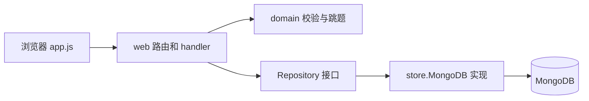

# 从 Survey Studio 学 Go

这份导读按“先运行，再沿请求读代码”的顺序展开。目标是能解释一次问卷保存、一次带跳题的提交以及一次统计查询，并能用测试验证自己的理解。所有路径和示例都对应当前仓库；文中的短代码片段用于阅读，不需要复制回源码。

## 1. 先运行一次完整流程

在仓库根目录检查 Go，然后启动服务：

```sh
go version
go mod download
python3 scripts/with-local-mongo.py go run ./cmd/server
```

项目的 `go.mod` 要求 Go 1.26 或更新版本。`scripts/with-local-mongo.py` 会读取已有的本地 MongoDB 配置，默认位置是 `~/docker/mongodb/.env`；也可通过 `LOCAL_MONGO_ENV` 指定路径。脚本将连接信息放入子进程的环境变量，不打印密码。它默认选择 `questionnaire_lab1` 数据库。

如果已有可用的 `MONGO_URI`，也可以直接运行：

```sh
export MONGO_URI='mongodb://127.0.0.1:27018/?directConnection=true'
export MONGO_DB='questionnaire_lab1'
go run ./cmd/server
```

这里的地址适用于仓库 `compose.yaml` 的本地 MongoDB；使用这套环境时先执行 `docker compose up -d mongodb`，等数据库就绪后启动 Go 服务。Go 程序读取进程环境变量，不会自动加载 `.env.example` 或 `.env`。

浏览器打开 `http://127.0.0.1:8080`，按顺序完成：注册 → 创建问卷 → 添加题目 → 保存草稿 → 发布 → 打开填写链接 → 提交 → 查看统计。可以先创建单选和文本两道题，再给单选题配置“选择某项后结束”，观察被跳过的必答文本题是否还需要回答。

阅读入口是 [cmd/server/main.go](../cmd/server/main.go)：`main` 创建数据库连接，把它交给 `web.New`，再调用 `ListenAndServe`。`go run ./cmd/server` 会编译并启动这个 `main` 包。按 Ctrl+C 后，代码通过 `signal.Notify` 接收信号，并调用 `Shutdown` 给进行中的请求留出结束时间。

## 2. 先认清四个代码位置

| 位置 | 当前职责 | 首先关注什么 |
| --- | --- | --- |
| [internal/domain/models.go](../internal/domain/models.go) | 问卷、题目、规则、答案的数据结构 | `struct`、切片、指针、字段标签 |
| [internal/domain/logic.go](../internal/domain/logic.go) | 校验与跳题计算 | 函数、多返回值、错误、循环 |
| [internal/web/server.go](../internal/web/server.go) | HTTP 路由、登录校验、JSON 输入输出 | 方法接收者、接口、请求上下文 |
| [internal/store/mongo.go](../internal/store/mongo.go) | MongoDB 文档、索引、更新、聚合 | 数据库操作、乐观锁、唯一约束 |

页面的请求来自 [internal/web/static/app.js](../internal/web/static/app.js)。前端使用原生 JavaScript，Go 后端使用标准库 `net/http`。学习主流程不需要先掌握泛型或大型 Web 框架；测试中的泛型 JSON 解码辅助函数可以稍后再读。

可以把一次请求画成下面的路径：



`domain` 不访问数据库；HTTP handler 组合业务计算与存储操作。

## 3. 用模型学习 struct、切片与字段标签

`models.go` 中的真实结构：

```go
type Option struct {
    ID    string `json:"id" bson:"id"`
    Label string `json:"label" bson:"label"`
}
```

`type Option struct` 定义一个有名称的结构体类型；`ID` 和 `Label` 是字段。Go 通过名称首字母大小写控制跨包可见性：这些大写字段可以被其他包访问，也能被 JSON/BSON 编解码器处理。

反引号内的内容是字段标签。`json:"id"` 指定 HTTP JSON 中的名字，`bson:"id"` 指定 MongoDB 文档中的名字。它们不会自动验证字段是否合理；值的业务约束在 `ValidateSurvey` 中检查。

`Survey` 的主键字段是：

```go
ID string `json:"id" bson:"_id"`
```

因此浏览器看到 `id`，数据库存为 `_id`。同一个 Go 字段可以有不同的外部表示。`User.PasswordHash` 使用 `json:"-"`，表示 JSON 编码时不输出该字段；MongoDB 仍通过 `bson:"passwordHash"` 保存哈希。

接着看三个常见类型：

- `Questions []Question`：题目的切片。题目按顺序排列，默认下一题就是切片中的后一项。
- `Answers map[string]any`：键是题目 ID，值可能是字符串、多选数组或数字。`any` 是空接口的别名，具体类型在运行时检查。
- `Deadline *time.Time`：指向时间值的指针。`nil` 表示没有截止时间。

校验规则也使用指针，例如 `Min *float64`：`nil` 表示没设置下限，指向 `0` 则表示下限确实是零。如果直接使用 `float64`，零值无法同时表达这两种含义。读取非空指针所指的值写作 `*v.Min`，取得变量地址写作 `&value`。

`Response.UserID` 的标签带 `omitempty`。匿名提交时 handler 不给它赋值，空字符串会被省略，所以存储的匿名回答没有 `userId` 字段。匿名回答仍要求登录；服务端用单独的去重键限制同一账号的重复提交。

## 4. 从 net/http 路由进入 handler

`web.New` 中有这些路由：

```go
m.HandleFunc("POST /api/surveys", s.create)
m.HandleFunc("PUT /api/surveys/{id}", s.update)
m.HandleFunc("POST /api/surveys/{id}/publish", s.publish)
```

模式同时包含方法和路径；`{id}` 是路径参数，在 handler 中通过 `r.PathValue("id")` 获取。`s.create` 是 `Server` 的方法，它的声明形式是：

```go
func (s *Server) create(w http.ResponseWriter, r *http.Request) {
```

括号中的 `(s *Server)` 是方法接收者，让函数可以使用 `s.repo` 等服务器状态。`r` 是请求，`w` 用于写状态码、响应头和响应正文。

读取 `create` 时，按这几个步骤理解：先认证，再解码 JSON，生成服务端字段，执行 `domain.ValidateSurvey`，调用存储，最后返回 `201`。输入中的 `OwnerID`、`Status`、`Revision` 等字段会由服务端设置，问卷归属取自当前会话。

代码反复使用以下写法：

```go
if err := domain.ValidateSurvey(&survey); err != nil {
    fail(w, 400, err.Error())
    return
}
```

`:=` 声明并赋值；这里的 `err` 只在 `if` 语句的作用域内存在。Go 通常把错误作为返回值，而不是通过异常控制日常流程。错误处理后立即 `return`，避免继续保存不合法数据。

`decode` 把 JSON 写入传入的结构体指针，并限制请求体大小、拒绝未知字段和多个连续 JSON 值。`write` 使用 `json.NewEncoder(w).Encode(v)` 输出 JSON。请求中解码到 `any` 的 JSON 数字通常是 `float64`，JSON 数组是 `[]any`；后续的领域逻辑负责检查与规范化。

最外层 `guard` 为请求设置上下文：

```go
ctx, cancel := context.WithTimeout(r.Context(), 15*time.Second)
defer cancel()
next.ServeHTTP(w, r.WithContext(ctx))
```

`context.Context` 传递取消信号和截止时间。`defer cancel()` 会在当前函数退出时释放相关资源。handler 把 `r.Context()` 继续传给 MongoDB 操作，使数据库工作能够响应请求取消或超时。上下文不会自动中断任意普通 Go 计算，也不会把已经写入的数据回滚。

## 5. 核心业务：答案校验、下一题、完整提交

先读 [logic.go](../internal/domain/logic.go) 中这三个函数签名：

```go
func ValidateAnswer(q Question, value any) (any, error)
func NextQuestion(s *Survey, questionID string, answer any) string
func ValidateSubmission(s *Survey, answers map[string]any) (map[string]any, []string, error)
```

`ValidateAnswer` 的两个返回值分别是规范化后的答案和错误。单选得到字符串，多选规范化成 `[]string`，数字规范化成 `float64`。校验包括合法选项、重复选择、长度、数值范围和整数要求。可选题的 `nil` 可以通过；必答题的 `nil` 会报错。

文本长度使用 `utf8.RuneCountInString`。`len("中文")` 是 UTF-8 字节数，而 rune 计数是 2。rune 是 Unicode 码点，不保证等于视觉上一个完整字符：组合附加符号、部分 emoji 序列可能由多个码点组成。

`NextQuestion` 按规则顺序查找，第一条匹配规则决定跳转；没有命中则前往后一题。`END` 表示结束。单选支持 `eq`，多选支持 `contains`、`contains_all`，数字支持 `eq`、`gt`、`gte`、`lt`、`lte`。`ValidateSurvey` 预先保证跳转只指向后续题目或 `END`，从结构上排除向后跳和循环。

例如，第一题选择 `a` 后跳到第三题：

```go
Rule{Operator: "eq", Value: "a", Target: "q3"}
```

如果第二题必答，但实际路径是 `q1 → q3 → END`，提交时不要求第二题的答案。`ValidateSubmission` 从第一题出发，逐题执行校验和跳转：

```go
answer, err := ValidateAnswer(q, answers[id])
```

它记录实际访问的题目，再检查提交的每个答案键是否属于这条路径。提交一个已经跳过的 `q2`，即使值是 `nil`，也会被拒绝。调用者得到规范化的答案 map、服务端计算的路径切片和错误。

这里也能学到 map 的两个读取方式：`answers[id]` 直接取值；`value, exists := answers[id]` 额外判断键是否存在。对于 `map[string]any`，键不存在与键存在但值为 `nil`，单次取值都会得到 `nil`，需要第二个布尔返回值来区分。

## 6. Repository 接口怎样连接 HTTP 与 MongoDB

`server.go` 声明的 `Repository` 接口包含如下方法签名：

```go
Survey(context.Context, string) (*domain.Survey, error)
CreateSurvey(context.Context, *domain.Survey) error
UpdateDraft(context.Context, *domain.Survey, int) error
InsertResponse(context.Context, *domain.Response, string) error
```

这些是接口内部的节选。HTTP 层需要的是“能读取、保存问卷的对象”。`internal/store/mongo.go` 中的 `*Store` 实现接口要求的全部方法，因此可以传给 `web.New`。Go 的接口是隐式满足的，不需要写 `implements Repository`。

理解这层关系后再读 `store.New`：它连接并探测 MongoDB，然后执行 `Init` 创建集合校验和索引。`collectionSchemas` 检查文档形状与基础字段类型；更完整的题目和跳题业务规则由领域层负责。`schemaVersion` 表示文档格式版本，`revision` 表示一份问卷被更新到哪个版本，两者用途不同。

草稿保存使用乐观锁，也称比较后更新（CAS）。`UpdateDraft` 的查询条件包含当前版本：

```go
bson.M{"_id": survey.ID, "ownerId": survey.OwnerID,
    "status": "draft", "revision": expectedRevision}
```

更新同时执行 `$set` 和 `$inc: {revision: 1}`。两个页面都读到版本 1 时，第一个保存匹配成功并升到版本 2；第二个携带版本 1 保存，已经匹配不到文档，返回 `ErrConflict`，HTTP 层映射成 `409`。查询条件与更新在同一次文档更新操作中执行。

回答去重由 MongoDB 唯一索引保证。`responses` 在 `(surveyId, dedupeKey)` 上建立部分唯一索引，只约束存在 `dedupeKey` 的文档。禁止重复时，服务端根据问卷 ID 和当前账号 ID 生成哈希键；允许重复时，不写这个字段。匿名和实名切换不会绕过同一问卷的去重规则。

会话使用 `expiresAt` 的 TTL 索引清理过期文档。TTL 清理不是立即完成，所以 `SessionUser` 查询还会检查 `expiresAt > 当前时间`。统计则使用 MongoDB 聚合：先按问卷和已回答字段匹配，再分组计数、收集值，数字题计算 `$avg`；选择题计数随后在 Go 中整理成前端需要的结构。

## 7. 沿一次真实操作对照文件

| 页面操作 | HTTP 请求 | `server.go` 入口 | 后续关键调用 |
| --- | --- | --- | --- |
| 创建问卷 | `POST /api/surveys` | `create` | `ValidateSurvey` → `CreateSurvey` |
| 保存草稿 | `PUT /api/surveys/{id}` | `update` | `owned` → `ValidateSurvey` → `UpdateDraft` |
| 发布 | `POST /api/surveys/{id}/publish` | `publish` | 检查题目和截止时间 → `Transition` |
| 打开填写页 | `GET /api/public/surveys/{id}` | `public` | `publicSurvey` → 认证与读取问卷 |
| 回答后下一题 | `POST /api/public/surveys/{id}/next` | `next` | `ValidateAnswer` → `NextQuestion` |
| 最终提交 | `POST /api/public/surveys/{id}/responses` | `submit` | `ValidateSubmission` → 再检查开放状态 → `InsertResponse` |
| 查看统计 | `GET /api/surveys/{id}/stats` | `stats` | `owned` → `Stats` 聚合 |

前端 `app.js` 的“保存并发布”先保存草稿，再发发布请求；编辑已经发布的问卷会被拒绝。填写页的每次“下一题”会请求后端校验并取得下一题 ID，最后只提交 `anonymous` 和 `answers`。最终提交仍完整重算路径，因此不依赖浏览器之前是否真的逐次调用过 `/next`。

发布后的题目被冻结，使已有答案和统计中的题目含义保持稳定。关闭和截止时间在提交前检查；当前实现允许“最终开放检查通过后，另一请求关闭问卷，而这次回答随后完成写入”的并发时序。阅读代码时要区分一次普通检查与数据库中的原子操作。

统计支持 `?questionId=q3` 查询一题。返回的 `totalResponses` 仍是整份问卷的提交数量；该题 `answered` 是实际回答这一题的数量，跳题后两者可能不同。

## 8. 用测试检查理解

先运行不要求 MongoDB 的测试：

```sh
go test ./internal/domain -v
go test ./internal/web -run TestIntegrationHTTPGuardAndJSON -v
go test ./...
go vet ./...
```

[logic_test.go](../tests/unit/domain_test.go) 使用表驱动测试：把输入、预期值和是否成功放进切片，再用 `t.Run` 遍历。遇到失败时输出具体用例名，比只看页面现象更容易定位原因。

[集成测试文件](../tests/integration/http_test.go) 中的 `TestMongoHTTPIntegration` 在没有 `INTEGRATION_MONGO_URI` 时会明确跳过。要真正验证数据库、HTTP 和并发去重，可以使用现有本地数据库配置：

```sh
python3 scripts/with-local-mongo.py go test -count=1 -race ./...
```

或者显式指定可用于集成测试的 MongoDB：

```sh
INTEGRATION_MONGO_URI='mongodb://127.0.0.1:27018/?directConnection=true' \
  go test -count=1 -race ./...
```

测试为每次运行生成独立的 `questionnaire_test_<随机值>` 数据库，结束时清理该数据库。它启动真实 HTTP 测试服务器，使用独立 Cookie jar 模拟多个登录用户，并检查 MongoDB 中实际保存的文档。

并发用例通过 `go func(...)` 启动多个 goroutine，用 channel 同时放行请求，用 `sync.WaitGroup` 等待完成，验证同一账号并发提交时只保存一份。不要把这里的 `-race` 与业务去重混为一谈：`-race` 检测 Go 内存访问的数据竞争；唯一索引及 HTTP 状态、文档数量断言验证业务上的并发正确性。`-count=1` 禁用测试结果缓存，让测试实际再执行一次。

## 9. 推荐阅读顺序与三个小练习

按 `models.go → logic.go → logic_test.go → server.go → mongo.go → integration_test.go → main.go` 阅读。第一遍先跟踪一条成功请求；第二遍看它在哪些位置提前返回错误；第三遍再看接口、上下文和并发。

下面三个练习只需要在测试文件中添加用例，不改动运行中的数据或业务功能：

1. **分清文本字节数和 rune 数。** 在 `logic_test.go` 增加测试，设置文本最大长度为 2，比较 `"中文"`、`"中文🙂"` 与 `"e\u0301"`。先写下预期结果，再用 `go test ./internal/domain -run Test你的测试名 -v` 检查。解释为什么最后一个输入的 rune 数是 2。
2. **验证第一条规则优先。** 构造数字题，两条规则分别为 `gte 10 → q2` 和 `gte 18 → END`，回答 20 时预测下一题；交换规则顺序后再预测。为两个顺序分别写断言，观察 `NextQuestion` 的顺序语义。
3. **区分“没回答”和“回答了被跳过的题”。** 构造 `q1 → q3` 的问卷，令 `q2` 必答。先提交 `q1` 与 `q3`，断言返回路径正确；再额外加入 `q2: nil`，断言提交失败。检查错误来自 `ValidateSubmission` 的哪个循环。

每完成一个练习，运行 `gofmt` 格式化修改的 Go 文件，再执行 `go test ./internal/domain`。能通过测试说明并解释结果之后，再回到页面观察相同规则如何表现。

测试目录已经统一为 `tests/`；新增真实浏览器验收及旧数据兼容回归，命令与分层见 [测试说明](testing.md)。
